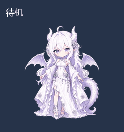

# 小龙娘 · Dragon Maiden Pet

面向 ChatGPT Work 自定义桌宠的小龙娘动画素材包：白发、紫瞳、龙角、蝠翼与白紫长裙。

## 包含什么

- 九种状态：待机、向右飞、向左飞、招呼、起飞、失落与恢复、等待回应、思考工作、检查确认。
- 十六个看向方向；左右飞行分别绘制，服饰并非简单镜像。
- 一张原生透明 RGBA 图集，保留半透明边缘，未做绿幕抠图或边缘内缩。
- 逐帧预览页面、各动作 GIF、完整播放视频和布局说明。

图集为 1536 × 2288 像素，8 列 × 11 行，单格 192 × 208。前九行是动作，第十、十一行是看向方向；57 个动作格、16 个方向格，其余 15 格为空。具体坐标见 [布局文件](final/spritesheet-manifest.json)。

## 预览

下载并解压整个仓库，打开 `index.html` 即可预览。若浏览器限制本地文件，可在此文件夹运行 `python preview.py`，然后访问 http://127.0.0.1:8780 。脚本只提供本地静态预览，不安装依赖。

可切换动作、暂停逐帧检查，并切换深色、白色、灰色背景。GIF 和视频使用深色背景便于展示；实际导入使用 [透明 PNG 图集](final/spritesheet-extended.png)。

## 在 ChatGPT Work 中使用

本仓库提供素材，不是独立的操作系统桌宠程序，也不包含自动安装器。需要客户端支持自定义 Pets，以及可用的导入工具。

可将仓库链接交给支持该流程的助手，并说明：使用 `final/spritesheet-extended.png` 和相邻布局文件，先验证并预览现有素材，再导入名为“小龙娘”的自定义桌宠；保持定稿像素，不重新生成动作。是否可导入取决于当前客户端和账号功能。

## 制作说明

部分原动作来自发布者已有素材，并经过逐帧处理；招呼复用说话动作，跳跃改用起飞动作。其他补充动作、左右飞行与视线素材采用 AI 辅助生成，并经人工检查、修正和审核。发布包仅包含定稿，不含 PSD、制作废稿或个人账号信息。

检查摘要见 [质量记录](qa/release-validation.json)，所有发布文件的摘要见 `SHA256SUMS.txt`。

## 权利与项目关系

本项目为非官方素材项目，与 OpenAI 无隶属或背书关系。ChatGPT 与 OpenAI 名称仅用于说明兼容目标。

本发布尚未授予统一的开源许可证；公开可查看不等于可任意再授权或商用。原始角色、美术和其他素材的权利归相应权利人，逐帧处理或 AI 补充不会替代原素材所需的授权。详见 [NOTICE](NOTICE.md)。
